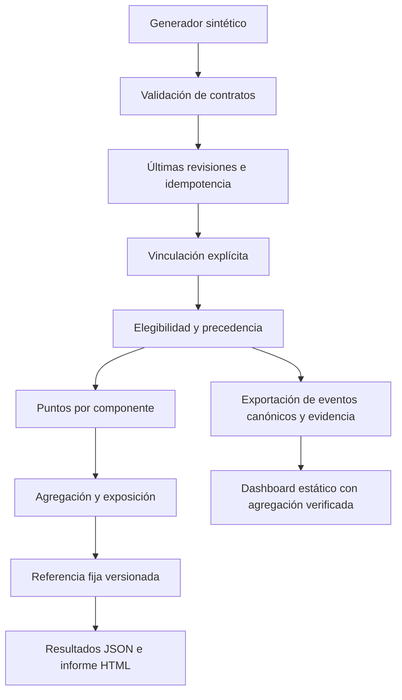

# Arquitectura

## Monolito modular

- `synthetic.py`: escenarios reproducibles sin copiar registros reales.
- `engine.py`: reglas y cálculo independientes de la interfaz.
- `cli.py`: generación y presentación local. Escapa texto al escribir HTML.
- `dashboard.py`: exporta contribuciones canónicas y evidencia vigente para el navegador.
- `dashboard/analytics.js`: agrega contribuciones y exposición; verifica paridad contra el motor Python.
- `dashboard/app.js`: filtros, gráficas SVG, tablas, detalle, navegación y CSV.
- `config/`: política y catálogos ficticios versionados.
- `tests/`: ejemplos manuales, invariantes y aceptación completa.

No hay red ni credenciales en ejecución. La entrada queda preservada en el archivo sintético; los resultados incluyen hashes de datos y configuración. El informe HTML es estático y no envía información a terceros.

## Decisiones

1. Biblioteca estándar para una demo sin instalación de dependencias de ejecución.
2. JSON para inspección y auditoría del MVP.
3. Referencias explícitas para no presentar coincidencias aproximadas como identidad probada.
4. Rechazar conflictos en vez de resolverlos silenciosamente.

## Evolución prevista

SQL/DuckDB y Parquet para análisis de mayor volumen; entidades de asignaciones temporales y validaciones históricas; API solo después de estabilizar contratos. La interfaz interactiva v0.2 es estática y no escribe sobre las fuentes. No hay adaptadores institucionales reales implementados.
